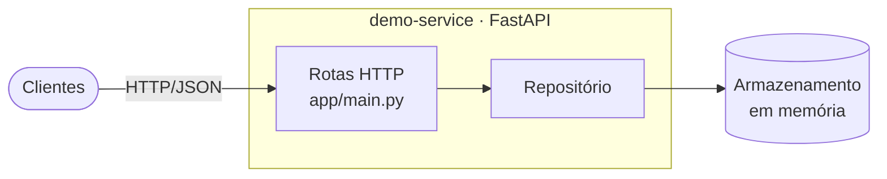
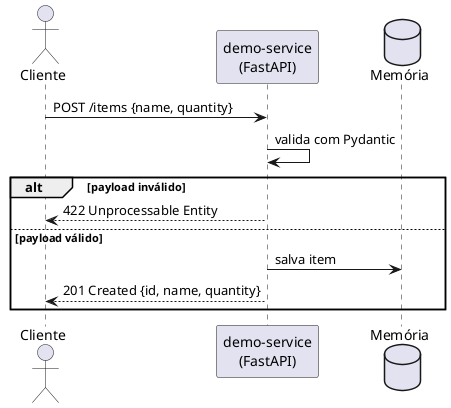

# Arquitetura

## Visão de componentes

| Componente | Responsabilidade |
|------------|------------------|
| `app/main.py` | Rotas HTTP, validação de entrada (Pydantic) |
| Repositório em memória | Armazena itens durante a vida do processo |

## Fluxo: criar um item

## Dependências

- **Upstream**: nenhuma.
- **Downstream**: qualquer cliente HTTP que consuma a `demo-api`.

## Decisões relevantes

- [ADR 0001: escolha do FastAPI](adr/0001-escolha-fastapi.md)

!!! warning "Limitação conhecida"
    O armazenamento é em memória: os dados se perdem a cada restart. É intencional nesta PoC.
